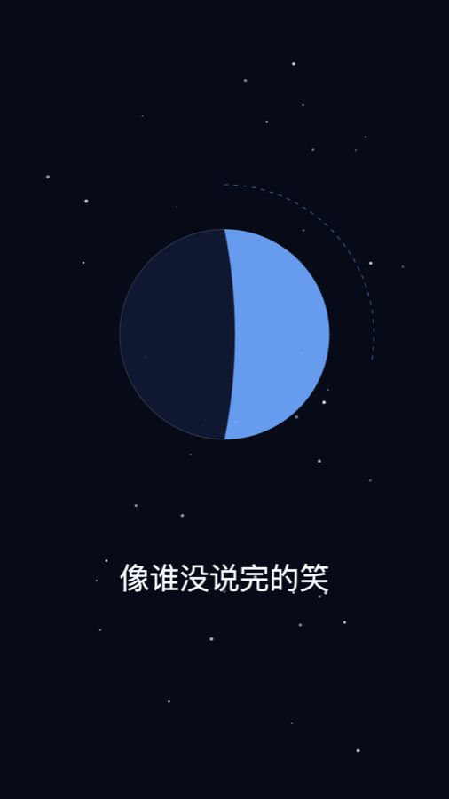
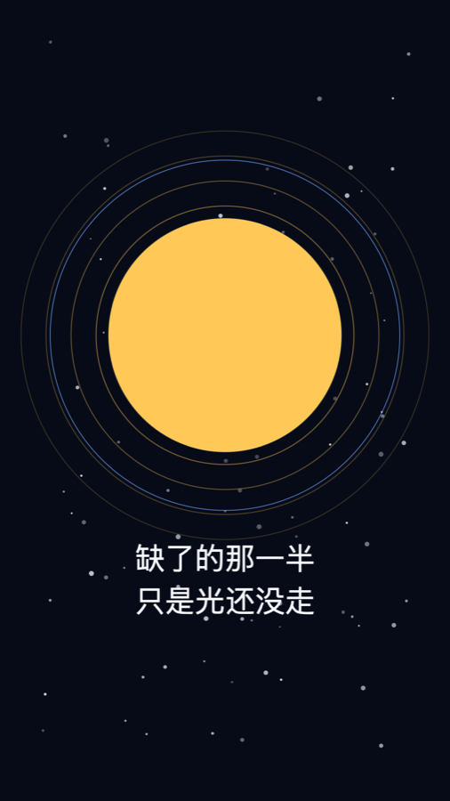

# music-mv

一个 WorkBuddy / Claude 风格的 Skill：**给一首歌做竖屏 MV**。给一个带人声的 mp3 和它的歌词，产出一条 ≤60 秒的 1080×1920 mp4 —— 歌词跟着真实人声出现，画面跟着鼓点动，四屏全部由代码画出来，不用任何外部图片素材。

作者微信：**staraiwork**（用的时候卡住了可以直接找我）

## 先看效果

下面三张是示例《月亮在等你》的静帧，出自 57 秒竖屏成片：

| 前奏 | 主歌 | 副歌 |
|---|---|---|
|  |  |  |

> 完整源码、分镜、九句歌词时间轴在 [`examples/moon/`](examples/moon/)。仓库不带音频文件，歌由使用者自备。

## 工作原理一图看懂


图只画流程主干：输入 → 五步 → 产出，不带说明文字。配色是亮绿点缀 + 浅绿卡片 + 深墨蓝黑，跟「音乐 MV，先有歌」那页 PPT 一套。字号按「铺满 PPT 一页后仍可读」定：卡片正文 24px、卡片标题 34px、主标题 52px。

**放进 PPT**：直接把 [`assets/diagram/工作原理.svg`](assets/diagram/工作原理.svg) 拖进 PowerPoint / Keynote，右键「转换为形状」就能逐个改文字、改颜色。图是 16:9、系统字体、纯矢量，所有样式写成 inline 属性，不依赖外部图片或网络字体。`工作原理.png` 是 2 倍图兜底，`工作原理.html` 和 `build.py` 是源文件。

## 一、它怎么工作

```
song.mp3 + 歌词.txt ──▶ 探歌（ffprobe + ASR）──▶ 写分镜【等你确认】──▶ 铺 Remotion 项目
                                                                          │
     mv.mp4 ◀── 渲染 ◀── 逐屏写画面、逐屏截图 ◀── 对时间轴【等你听预览】◀──┘
```

三个关键设计：

1. **先探歌，没歌不搭项目。** 曾经先渲染完一版占位伴奏，才发现歌生成不了，整条链路白跑。现在第一道门就是检查音频文件。
2. **时间从真实人声来，不按 BPM 猜。** 用 ASR 转写量出「第一句」「副歌第一句」的秒数，再定四段边界和逐句时间轴。段内等分只是初稿，必须让用户听 20 秒预览校准。
3. **歌词一字不改。** 段落标签、空行、句中的空格都是数据：空格是换气点，也是字幕折行点，改了会出现只剩一个字的孤行。

## 二、要配置什么

### 1. 你要提供的（只有两样）

| 输入 | 要求 | 说明 |
|---|---|---|
| `song.mp3` | **必须**，带人声 | 放在项目 `public/song.mp3`。mp3 / wav / m4a 都行，转成 mp3 最省事。长于 60 秒也能用，Skill 会决定截取哪一段 |
| `歌词.txt` | **必须**，原文 | 含 `[Intro]` `[Verse]` `[Chorus]` `[Outro]` 标签、段落间空行、**句中的空格一字不改** |

**歌从哪来**：本 Skill 不生成歌，只消费你给的文件。最稳的是你在 MiniMax Audio / 其他音乐网页版生成后下载 mp3。音乐生成 API 多数账号用不了（MiniMax 2026-08-20 起对新用户返回 410 / 2153，充过钱也不解决）；Fish Audio 的 REST API 只有 TTS 没有音乐生成。完整实测记录见 [`references/song-sources.md`](references/song-sources.md)，网页版提示词模板也在里面。

**不需要你提供**：歌名、主意象、画幅、时长、配色、字体、外部素材、任何 API Key。这些都有默认值，写在 `src/content.ts` 和 `assets/tokens.ts` 里，想改再改。

### 2. 本机环境（装一次就行）

| 依赖 | 必须？ | 用途 / 检查命令 |
|---|---|---|
| Node.js ≥ 18 | 必须 | Remotion 跑在 Node 上。`node -v`（实测通过：22.22.2）。没有就去 https://nodejs.org 装 LTS |
| npm | 必须 | 随 Node 一起装。装依赖务必加国内镜像：`npm install --registry=https://registry.npmmirror.com` |
| ffmpeg / ffprobe | 必须 | `probe_song.py` 用它量时长、查封面流、做静音检测；验收成片也用它。Mac：`brew install ffmpeg` |
| Python 3 | 必须 | 只跑 `scripts/probe_song.py`，无第三方包 |
| Chrome | 建议装 | 渲染时若下载 Chromium 失败，命令加 `--browser-executable` 指向本机 Chrome 即可（Mac 路径见第六节） |
| ASR 转写能力 | 必须 | 量逐句时间用。WorkBuddy 里用 `AudioTranscribe`；命令行可用 faster-whisper / whisper.cpp 带词级时间戳 |

**明确不需要配的**：没有 `.env`，没有 API Key，没有账号注册，没有云服务，没有素材下载，没有网络字体。整个渲染过程离线可跑。

### 3. 项目里要改的（只有三处）

铺好项目后，换一首歌只动这三个文件，画面代码一行不用改：

| 文件 | 改什么 |
|---|---|
| `public/song.mp3` | 换成你的歌 |
| `歌词时间轴.json` | 九句（或 N 句）的 `start` / `end`，单位秒，相对 MV 开头 |
| `src/content.ts` | `songTitle` 歌名；`intro / verse / chorus / outro` 四段秒数，总长 ≤60 秒 |

想换风格再改 `src/tokens.ts`（配色、字号、间距、动画帧数全在这一个文件）；想做横屏把 `Root.tsx` 的 `tokens.canvas` 换成 `tokens.canvasHorizontal`。

### 4. 两个必须你开口的地方

分镜写完等你说「可以」；20 秒预览出来等你听一句「第几句早了/晚了半秒」。其余全自动。

## 三、安装

```bash
git clone https://github.com/seeyouintokyo/music-mv-skill.git
cp -R music-mv-skill ~/.workbuddy/skills/music-mv
```

项目级安装就放到 `<项目>/.workbuddy/skills/music-mv`。Claude Code 同理放 `~/.claude/skills/music-mv`。

## 四、用法

在 WorkBuddy 里直接说：

```
用 music-mv 给《月亮在等你》做一条竖屏 MV。
歌在 MV套件/月亮在等你.mp3，歌词按 歌词.txt，57 秒以内。
先给我看分镜。
```

它会先量歌、出四屏分镜，你说「可以」之后才铺项目、排时间轴、写画面、渲染。成片在项目 `out/mv.mp4`。

命令行单独跑：

```bash
node scripts/scaffold.mjs my-mv --song 我的歌.mp3 --lyrics 歌词.txt --title "歌名"
cd my-mv
python3 tools/probe_song.py public/song.mp3       # 量真实参数
npm install --registry=https://registry.npmmirror.com
# 按 ASR 结果改 src/content.ts 和 歌词时间轴.json
npx remotion render src/index.ts Main out/preview.mp4 --scale=0.5 --frames=0-599
npx remotion still src/index.ts Main out/check-S1.png --frame=120
npx tsc --noEmit
npx remotion render src/index.ts Main out/mv.mp4
```

## 五、目录结构

```
music-mv-skill/
├── SKILL.md                          # 给 AI 读的作业流程和硬规则
├── scripts/
│   ├── scaffold.mjs                  # 一键铺出可运行的 Remotion 项目
│   └── probe_song.py                 # 量歌：时长、封面流、音量、静音间隙
├── assets/
│   ├── tokens.ts                     # 配色 / 字号 / 间距 / 动画节奏（换风格只改这个）
│   ├── scaffold/                     # 项目骨架：四屏、组件、hooks、content.ts、占位歌词
│   │   ├── package.json / tsconfig.json   # 版本锁定的依赖
│   ├── diagram/                      # 工作原理图：SVG（PPT 可编辑）+ PNG + HTML + 生成脚本
│   └── preview/                      # README 用的三张竖屏静帧
├── references/
│   ├── remotion-recipes.md           # 月相、轨道、光圈、星点、鼓点联动、歌词折行的画法
│   └── song-sources.md               # 歌的三条来源、MiniMax 410 实测、网页版提示词模板
└── examples/moon/                    # 已完成的《月亮在等你》：分镜、时间轴、全部源码、说明
```

## 六、几个常见坑

1. **`npm install` 太慢**：加 `--registry=https://registry.npmmirror.com`。
2. **渲染报下载浏览器失败**：命令后加 `--browser-executable="/Applications/Google Chrome.app/Contents/MacOS/Google Chrome"`；Windows 换 `C:\Program Files\Google\Chrome\Application\chrome.exe`。
3. **歌带封面流**：`ffmpeg -i 输入 -map 0:a:0 -c:a copy public/song.mp3` 只留音频。
4. **中文变方块**：字体必须走 `tokens.font.family`，别引网络字体。
5. **长句末行只剩一个字**：按歌词自带空格折行，见 `references/remotion-recipes.md` 第 7 条。
6. **画面不跟鼓点**：`<Series.Sequence>` 内的帧是相对帧，读音频要加 `OFFSET`，见 `references/remotion-recipes.md` 第 5 条。
7. **人声比字幕整体早**：裁切偏移没同步减到时间轴和节拍帧号，或者根本不该裁——长歌先算副歌对齐再决定。
8. **想用 API 生成歌**：先读 `references/song-sources.md`，别在 410 上反复重试。

## 七、许可

代码 MIT，见 [`LICENSE`](LICENSE)。仓库**不含任何歌曲、音频、API Key 或成片 mp4**；示例静帧由本仓库代码生成。你放进 `public/` 的歌版权归你。

用的时候出问题，微信找我：**staraiwork**。
